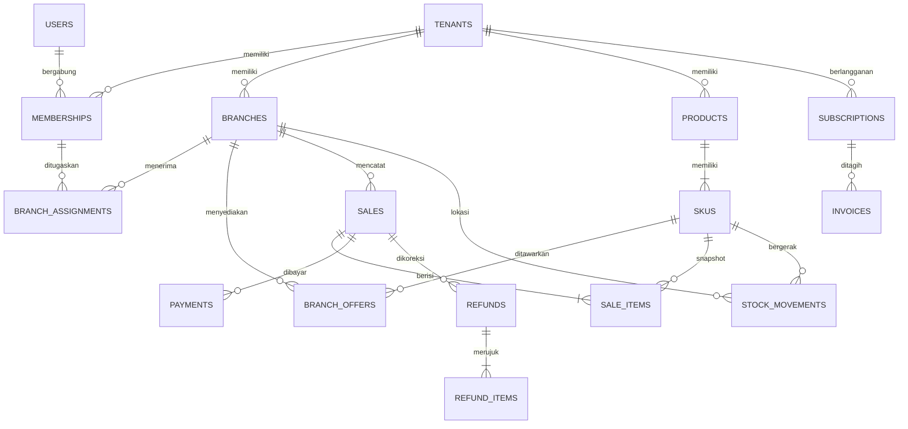

# Model data dan konsistensi

Tanggal: 14 Oktober 2026 · Versi 0.1 · Pendamping [rencana teknis](01-rencana-teknis.md).

Skema berikut adalah rancangan logis untuk diturunkan menjadi migrasi SQL pada backlog DB-01. Nama kolom utama dicantumkan; detail constraint dan migrasi belum dijalankan pada database.

## 1. Konvensi lintas tabel

- `id`: UUID acak yang dibuat client untuk transaksi offline, atau server untuk master data. UUID tidak menjadi sumber otoritatif waktu transaksi.
- Seluruh data bisnis memiliki `tenant_id NOT NULL`. Tabel operasional cabang juga memiliki `branch_id NOT NULL`. `users`, katalog permission global, dan inbox provider sebelum tenant teridentifikasi merupakan pengecualian terbatas.
- Entitas referensi tenant menyediakan `UNIQUE(tenant_id,id)`. Foreign key memakai pasangan tenant + ID agar relasi antar-tenant tidak mungkin terbentuk secara tidak sengaja.
- Referensi operasional yang wajib satu cabang memakai `UNIQUE(tenant_id,branch_id,id)` pada parent dan foreign key tiga kolom pada child. Contoh: payment tidak boleh menunjuk sale cabang lain.
- Waktu server menggunakan `timestamptz`. Simpan `occurred_at` yang dilaporkan perangkat, `received_at` server, `business_date`, dan timezone snapshot bila relevan.
- Nominal Rupiah `bigint`, kuantitas `numeric(18,3)`, tarif `numeric(9,6)`. Decimal/integer besar di API berupa string. Semua kalkulasi memakai decimal/integer dan pembulatan eksplisit.
- Master data memiliki `version`, `created_at`, `updated_at`, `archived_at`; update bersyarat memakai version. Data historis tidak dihapus lewat cascade dari master.
- Catatan posted bersifat append-only; status/projection boleh berubah lewat command terkontrol dan diaudit. Koreksi ledger menggunakan reversal, bukan edit nominal lama.
- Field sensitif tidak otomatis dikirim hanya karena berada pada baris yang boleh dibaca. DTO terpisah untuk kasir, manajer, owner, dan bootstrap offline.

## 2. Relasi inti

Diagram menyederhanakan tabel pendukung; constraint tenant/cabang tetap berlaku untuk semua relasi.

## 3. Identitas, bisnis, dan akses

| Tabel | Kolom utama | Aturan |
|---|---|---|
| `users` | id, auth_issuer, auth_subject, display_name, verified_email, email_verified_at, disabled_at | Unique(issuer,subject); email bukan identitas tenant |
| `tenants` | id, name, industry, timezone, currency, status | Currency IDR pada MVP; timezone tervalidasi |
| `memberships` | id, tenant_id, user_id, role, status, permission_version | Unique(tenant_id,user_id); role owner/manager/cashier |
| `branch_assignments` | tenant_id, membership_id, branch_id | PK gabungan; owner dapat scope semua cabang |
| `permission_grants` | tenant_id, membership_id, permission, scope_branch_id | Override eksplisit yang tidak melampaui hak pemberi |
| `staff_invitations` | id, tenant_id, email, role, scope, token_hash, expires_at, accepted_at | Token sekali pakai; scope divalidasi saat terima |
| `branches` | id, tenant_id, code, name, address, status, inventory_revision, closing_at, disabled_at | Unique(tenant_id,code); active/draining/inactive |
| `devices` | id, tenant_id, installation_id, public_key, status, last_seen_at | Unique(tenant_id,installation_id); rotasi/revokasi diaudit |
| `device_sessions` | id, tenant_id, device_id, membership_id, branch_id, revoked_at | Mengikat actor dan cabang; pergantian user bukan pergantian transaksi asal |
| `offline_leases` | id, tenant_id, session_id, issued_at, expires_at, paid_through, permission_version, key_id, claims_hash | Lease tersimpan untuk validasi upload historis |
| `report_recipients` | tenant_id, email, verified_at, verification_token_hash, version | Pergantian email tidak aktif sampai terverifikasi |

Penonaktifan cabang melalui `draining`: hentikan lease baru, tunggu ACK antrean perangkat dan habisnya lease lama. Perangkat yang hilang memerlukan keputusan owner tercatat; server tidak dapat membuktikan seluruh antrean lokal kosong. Late upload sah tidak dibuang meski cabang sudah inactive.

## 4. Katalog dan stok

| Tabel | Kolom utama | Aturan |
|---|---|---|
| `categories` | id, tenant_id, name, archived_at | Produk mengacu kategori tenant sama |
| `products` | id, tenant_id, category_id, name, kind, photo_key, active | kind goods/service |
| `skus` | id, tenant_id, product_id, code, variant_label, unit, stock_tracked, active | Unique(tenant_id,code), termasuk kode arsip |
| `branch_offers` | id, tenant_id, branch_id, sku_id, current_price_version, active | Unique(tenant_id,branch_id,sku_id) |
| `price_versions` | id, tenant_id, branch_id, sku_id, unit_price, cost_version_id, tax_rule_version, valid_from, valid_to, policy_hash | Append-only; interval tidak tumpang tindih untuk SKU/cabang |
| `cost_versions` | id, tenant_id, branch_id, sku_id, unit_cost, effective_at, reason | HPP standar; akses hanya permission biaya |
| `tax_rule_versions` | id, tenant_id, tax_rate, service_rate, rounding_rule, effective_at | Immutable setelah dipakai; default nol |
| `inventory_balances` | tenant_id, branch_id, sku_id, quantity, version | PK(tenant_id,branch_id,sku_id); projection ledger |
| `stock_movements` | id, tenant_id, branch_id, sku_id, delta_qty, reason, source_type, source_id, source_line_id, actor_id, occurred_at, posted_at, reversal_of | Delta != 0; sumber penjualan/refund/adjustment unik |
| `stock_adjustments` | id, tenant_id, branch_id, reason, actor_id, posted_at | Dokumen adjustment; alasan wajib |
| `stock_adjustment_items` | tenant_id, adjustment_id, sku_id, delta_qty, expected_balance_version | Cegah stock count berdasarkan saldo usang |
| `inventory_exceptions` | id, tenant_id, branch_id, sku_id, movement_id, type, status, resolution_note | Negative stock atau mismatch; penyelesaian diaudit |

Ledger memakai kuantitas bertanda: opening +10, sale −2, restock +5, refund layak jual +1. Saldo dihitung melalui penambahan delta dalam transaksi yang sama, tidak dari overwrite nilai stok yang dikirim client.

Setiap komit perubahan stok menaikkan `inventory_revision` cabang secara atomik dengan lock baris cabang sebelum lock SKU. Snapshot saldo menyertakan revision yang konsisten. Ini memudahkan penggabungan perubahan lokal; contention pada counter cabang perlu diukur saat load test. Perubahan HPP menerbitkan versi penawaran baru meskipun harga jual tetap, sehingga referensi biaya untuk snapshot berikutnya tidak ambigu.

Transaksi mengunci baris saldo dalam urutan SKU yang konsisten untuk mengurangi deadlock. Insert saldo pertama memakai upsert aman. Jika stock count mengirim hasil hitung absolut, server menghitung delta dari saldo/version yang dikonfirmasi; stale version mengharuskan review ulang.

Online menolak stok tidak cukup jika kebijakan cabang melarangnya. Offline tunai yang valid dapat menghasilkan saldo negatif dan exception. Jasa dengan `stock_tracked=false` tidak menghasilkan stock movement.

## 5. Penjualan, pembayaran, dan refund

| Tabel | Kolom utama | Aturan |
|---|---|---|
| `transaction_registry` | tenant_id, sale_id, payload_hash, recorded_at | PK(tenant_id,sale_id), tidak dipartisi; dedup permanen selama histori ada |
| `sales` | id, tenant_id, branch_id, device_id, actor_membership_id, local_sequence, receipt_number, occurred_at, received_at, business_date, lease_id, status, currency, gross, discount, tax, service_charge, total | Unique identitas dan nomor nota; nilai final server |
| `sale_items` | id, tenant_id, branch_id, sale_id, sku_id, quantity, name_snapshot, sku_snapshot, unit_snapshot, price_version_id, unit_price, discount, tax, total, unit_cost_snapshot, cost_known | Harga/HPP historis tidak berubah |
| `payments` | id, tenant_id, branch_id, sale_id, method, status, amount, tendered_amount, change_amount, money_account_id, external_reference, confirmation_source, confirmed_by, confirmed_at | Nilai settled mencukupi total; bukan dari status UI |
| `payment_events` | id, tenant_id, payment_id, source, event_key, state, occurred_at | Unique(source,event_key) dalam scope provider yang tepat |
| `refunds` | id, tenant_id, branch_id, sale_id, actor_id, reason, status, total, posted_at | Refund bukan update jumlah penjualan asal |
| `refund_items` | id, tenant_id, branch_id, refund_id, sale_item_id, quantity, restock_qty, amount, tax_reversal, cost_reversal | 0 ≤ restock_qty ≤ quantity; batas kumulatif dijaga dengan lock |
| `refund_payments` | id, tenant_id, branch_id, refund_id, payment_id, amount, status, money_account_id, confirmation_source | Pembayaran balik aktual dipisah dari permintaan refund |

Identitas lokal unik: `(tenant_id,device_id,local_sequence)`; sequence meningkat atomik dan tidak direset dalam instalasi. Nomor nota mencakup kode cabang, identitas instalasi unik yang dialokasikan server, dan sequence. Tampilan pendek boleh ditambahkan tetapi bukan unique key otoritatif.

Status sale: `completed`, `partially_refunded`, `refunded`; draft disimpan terpisah/lokal. Status pembayaran: `pending`, `confirmed`, `failed`, `voided`. Pencatatan manual transfer/QRIS hanya dianggap dikonfirmasi operator setelah pemeriksaan di luar aplikasi; response harus menyebut `confirmation_source=manual`, tidak mengesankan verifikasi gateway.

Usulan P0 mendukung satu metode pembayaran per penjualan. Skema memungkinkan beberapa payment, tetapi split payment belum menjadi fitur UI sampai aturannya disepakati. Refund parsial menghitung pengembalian pajak/diskon dari alokasi nota asal; refund terakhir menyerap sisa pembulatan.

Jika gateway POS ditambahkan: gunakan payment intent dan reservasi stok dengan expiry sebelum settlement. Status pending tidak boleh diperlakukan sebagai penjualan lunas. Kebutuhan tersebut termasuk gate PAY-01, bukan perilaku tersembunyi pada pencatatan manual.

## 6. Finance

| Tabel | Kolom utama | Aturan |
|---|---|---|
| `money_accounts` | id, tenant_id, branch_id, name, type, opening_entry_id, active | cash/bank/clearing; saldo awal memakai ledger, bukan ditambahkan dua kali |
| `cash_entries` | id, tenant_id, branch_id, account_id, category, signed_amount, occurred_at, posted_at, actor_id, source_type, source_id, source_line_id, reversal_of, note | Sumber efek uang unik; append-only |
| `account_transfers` | id, tenant_id, branch_id, from_account_id, to_account_id, amount, fee_amount, actor_id | Dua cash entries seimbang dalam satu komit; fee terpisah |
| `daily_finance_summaries` | tenant_id, branch_id, business_date, category, total, computed_at, watermark | Projection; dapat dibangun ulang |

Untuk MVP, transfer akun dibatasi dalam cabang yang sama; transfer antar-cabang memerlukan dua scope dan kebijakan tambahan. Saldo akun = jumlah seluruh entry bertanda, termasuk saldo awal. Pajak yang dipungut dapat berada dalam saldo uang, tetapi bukan otomatis pendapatan usaha.

## 7. Subscription dan billing

| Tabel | Kolom utama | Aturan |
|---|---|---|
| `plan_versions` | id, currency, base_price, extra_branch_price, tax_config, effective_at | Snapshot paket dan tarif; global terkontrol |
| `subscriptions` | id, tenant_id, plan_version_id, provider, provider_subscription_id, status, current_period_start, paid_through, branch_capacity, cancel_at_period_end, version | Satu langganan operasional saat ini per tenant |
| `subscription_changes` | id, tenant_id, subscription_id, from_capacity, to_capacity, effective_at, quote_id, status, target_branches | Upgrade/downgrade idempotent dan tidak overlapping ambigu |
| `billing_quotes` | id, tenant_id, subscription_version, amount, tax, fee, target_capacity, expires_at | Quote stale ditolak; angka client diabaikan |
| `invoices` | id, tenant_id, subscription_id, period_start, period_end, currency, subtotal, tax, fee, total, status, provider_reference | Detail harga dan periode immutable setelah terbit |
| `invoice_items` | id, tenant_id, invoice_id, description, quantity, unit_price, prorata_fraction, total | Pisahkan paket dasar, slot, pajak/biaya |
| `billing_events` | id, provider, provider_account_id, provider_event_id, tenant_id nullable, payload_encrypted, payload_hash, received_at, verification_status, processing_status | Unique(provider,provider_account_id,provider_event_id) |
| `billing_period_grants` | id, tenant_id, provider_transaction_id, starts_at, ends_at, capacity, revoked_at | Efek periode unik; mencegah webhook menambah masa aktif berulang |
| `entitlement_versions` | id, tenant_id, subscription_id, permissions, capacity, paid_through, created_at, revoked_at | Diturunkan dari pembayaran sah, bukan input mobile |

Inbox webhook yang belum diketahui tenant hanya dapat dibaca worker provider dengan privilege terbatas. Setelah merchant/invoice cocok, pemrosesan dilakukan dalam context tenant. Akses umum API tidak boleh melihat raw webhook.

## 8. Sinkronisasi, laporan, dan audit

| Tabel | Kolom utama | Aturan |
|---|---|---|
| `sync_events` | id, tenant_id, branch_id, device_id, operation_id, payload_hash, status, result_reference, rejection_code, received_at | Unique(tenant_id,device_id,operation_id) |
| `quarantined_operations` | id, tenant_id, branch_id, device_id, operation_id, encrypted_payload, reason, review_status | Tidak masuk angka penjualan sebelum disetujui; tetap bukti lokal |
| `idempotency_records` | tenant_id, actor_scope, operation_scope, key, payload_hash, status, response_ref | Key request umum; dedup sale permanen tetap pada registry |
| `outbox_events` | id, tenant_id, aggregate_id, event_type, payload, created_at, dispatched_at, attempts | Dibuat bersama perubahan domain |
| `consumer_receipts` | tenant_id, consumer_name, event_id, processed_at | PK gabungan; efek consumer hanya sekali secara transaksional |
| `change_feed` | tenant_id, feed_sequence, resource_type, resource_id, resource_version, branch_scope, tombstone | Delta terurut aman; jangan memakai sequence SQL mentah sebagai urutan komit |
| `daily_sales_summaries` | tenant_id, branch_id, business_date, gross, discounts, refunds, net_sales, cogs, cost_coverage, count, watermark | Pisahkan hari sale dan hari refund menurut laporan |
| `report_schedules` | id, tenant_id, timezone, next_run_at, enabled | Scheduler menghitung awal bulan lokal |
| `report_jobs` | id, tenant_id, scope_hash, period_start, period_end, cutoff, revision, format, status, progress, error_code | Unique laporan otomatis per scope/period/revision/format |
| `report_files` | id, tenant_id, job_id, object_key, checksum, bytes, row_count, expires_at, status | Hanya file final yang dapat diunduh |
| `email_deliveries` | id, tenant_id, report_bundle_id, recipient_version, provider_message_id, status, attempts | Unique pengiriman per bundle dan versi penerima |
| `audit_logs` | id, tenant_id, branch_id nullable, actor_id, action, target_type, target_id, redacted_diff, reason, request_id, created_at | Append-only; akses ketat dan retensi tersendiri |

## 9. Batas komit dan invariant

### Posting penjualan tunai

1. Verifikasi identitas, tenant/cabang, permission, lease atau entitlement, skema, harga dan hash.
2. Mulai transaksi database dan reservasi registry unik. Jika ada, cocokkan hash; kembalikan hasil lama bila sama atau conflict bila berbeda.
3. Lock saldo SKU dalam urutan tetap; validasi kebijakan stok.
4. Insert sale/items/payment; insert stock movements dan update balances; insert pemasukan kas bersumber payment.
5. Insert audit, sync result, dan outbox. Commit bersama. Hanya setelah commit beri ACK ke perangkat.

Invariant: satu sale menghasilkan satu set efek stok/uang walaupun upload diulang. Crash sebelum commit tidak menyisakan sebagian efek; crash setelah commit sebelum ACK aman di-retry.

### Posting refund

Lock sale/items dan payment asal, hitung sisa refundable, validasi branch dan izin. Commit refund/items, pembayaran balik yang sudah dikonfirmasi, restock yang disetujui, pembalikan uang, audit, dan outbox bersama. Untuk provider otomatis, permintaan eksternal terjadi melalui state machine/outbox, bukan menahan transaksi database sambil memanggil jaringan.

### Proyeksi asinkron

Worker insert `consumer_receipts` dan update agregat dalam transaksi yang sama. Event ulang tidak menggandakan metrik. Cache/dashboard menampilkan watermark terakhir. Rekonsiliasi terjadwal membandingkan total ledger dengan projection; tidak memperbaiki ledger secara diam-diam.

## 10. Indeks dan strategi pertumbuhan

| Tabel/query | Indeks awal |
|---|---|
| Riwayat sales per cabang | `(tenant_id,branch_id,occurred_at DESC,id DESC)` |
| Riwayat seluruh tenant | `(tenant_id,occurred_at DESC,id DESC)` |
| Item nota | `(tenant_id,sale_id)` |
| Histori stok SKU | `(tenant_id,branch_id,sku_id,posted_at,id)` |
| Cashflow akun/periode | `(tenant_id,branch_id,account_id,occurred_at,id)` |
| Assignment pengguna | Unique `(tenant_id,membership_id,branch_id)` |
| Lookup SKU | Unique `(tenant_id,code)` |
| Retry worker | Partial index status pending/retry pada waktu percobaan berikutnya |
| Laporan dan audit | `(tenant_id,created_at DESC,id DESC)`; scope cabang sesuai query |

Cursor pagination menggunakan pasangan waktu + ID; hindari OFFSET besar. Indeks final dibuktikan dengan query plan dan beban representatif, karena setiap indeks menambah biaya write/storage.

Saat partisi diperlukan: usulkan `recorded_month` yang dihitung server dan immutable; gunakan key sale `(tenant_id,recorded_month,id)` dan bawa partition key pada relasi detail. Registry `(tenant_id,sale_id)` tetap tidak dipartisi untuk dedup global. Lookup ID melewati registry yang menyimpan lokasi partisi. Partisi diterapkan melalui migrasi bertahap dengan validasi jumlah, checksum, serta penanganan transaksi terlambat.

Pembatasan unique key tabel terpartisi perlu diperhitungkan sebelum migrasi. [PostgreSQL partitioning](https://www.postgresql.org/docs/current/ddl-partitioning.html)

## 11. Data lokal mobile

| Tabel lokal | Isi |
|---|---|
| `session_cache`, `lease_cache` | Session metadata, signed lease, anchor waktu server |
| `catalog_cache`, `price_cache` | SKU/harga/config yang boleh diakses; tanpa HPP untuk kasir |
| `stock_cache` | Saldo server + watermark; proyeksi pending disimpan terpisah |
| `local_sales`, `local_sale_items`, `local_payments` | Snapshot penjualan lokal immutable |
| `sync_outbox` | Operation ID, payload canonical, hash, status, attempts, next_retry_at |
| `sync_inbox`, `sync_cursor` | Delta yang sudah diterapkan dan cursor per scope |
| `local_receipt_sequence` | Sequence instalasi, naik di transaksi lokal yang sama |
| `sync_conflicts` | Alasan karantina/penolakan dan tindakan yang tersedia |

Commit lokal mencakup sale/items/payment, proyeksi stok pending, sequence nota, dan sync_outbox dalam satu transaksi SQLite. Setelah ACK, tandai server committed; jangan menghapus pengurang stok pending sampai snapshot server yang diunduh terbukti sudah memuat sale tersebut, agar stok tidak melonjak atau berkurang dua kali.

## 12. Pemeriksaan sebelum migrasi disetujui

Wajib membuktikan foreign key lintas tenant/cabang ditolak, replay payload berbeda ditolak, refund bersamaan tidak melebihi nilai asal, kasir tidak memperoleh HPP, dan saldo ledger sama dengan projection setelah crash/retry. Bukti ini masuk integration test DB-01, SEC-01, POS-02, dan SYN-02.
